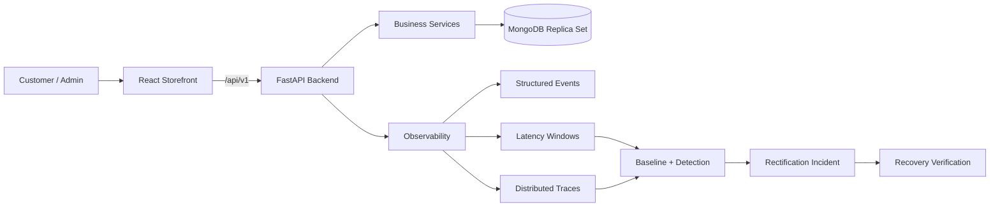
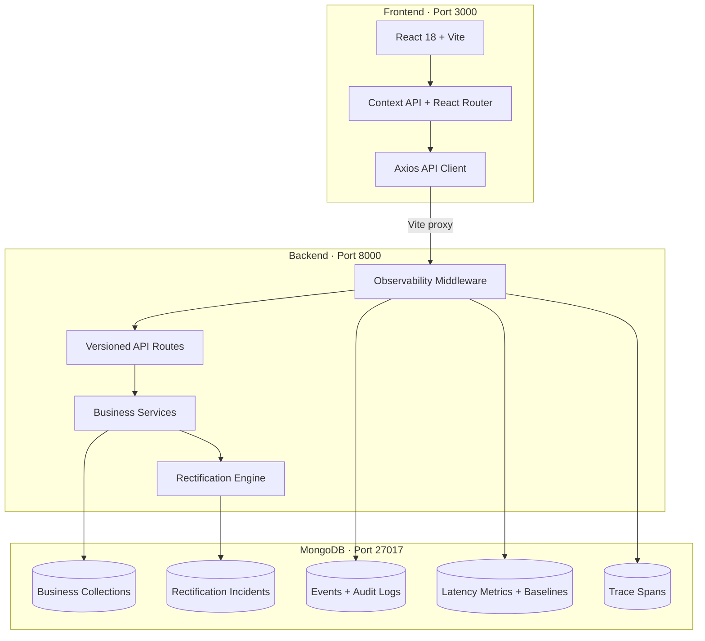
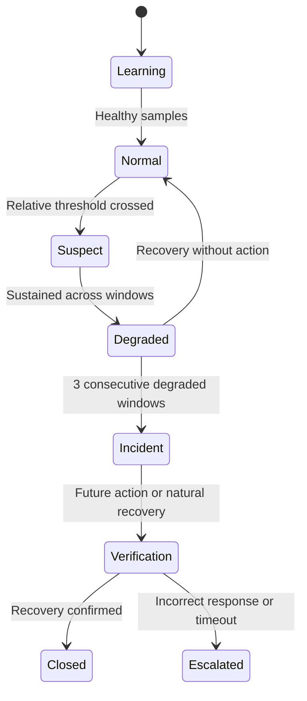
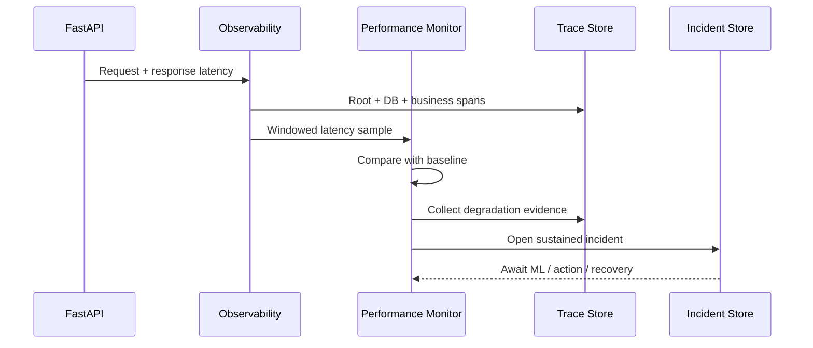
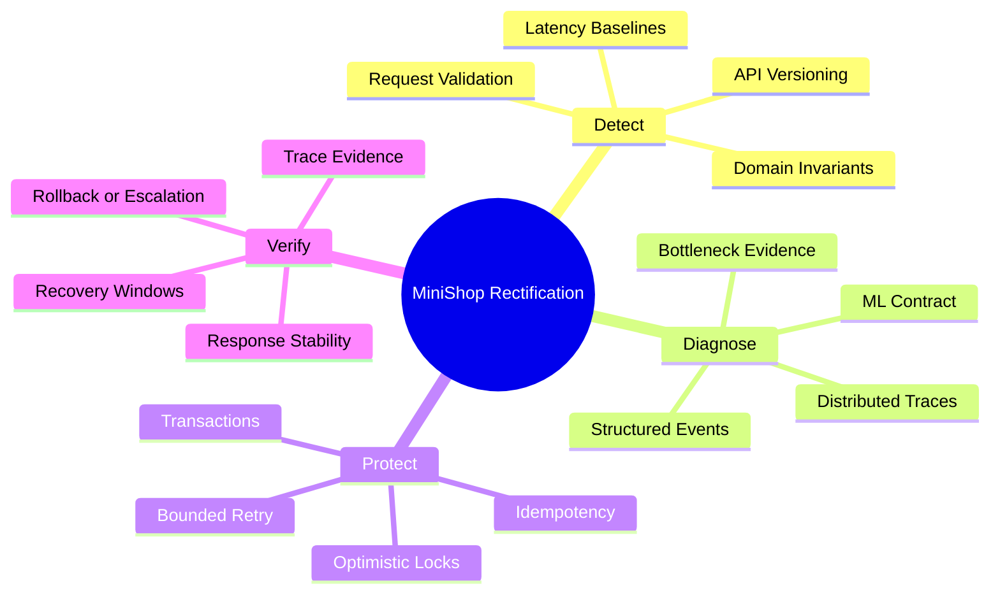

# <div align="center">MiniShop</div>

<p align="center">
  <strong>Application-Level Intelligent Fault Rectification POC</strong>
</p>

<p align="center">
  <a href="http://localhost:3000"></a>
  <a href="http://localhost:8000/docs"></a>
  
  
</p>

<p align="center">
  A full-stack e-commerce lab for detecting, diagnosing, and investigating application-level faults.
</p>

---

## ✨ What makes it special?

MiniShop is more than a demo store. It combines **real checkout workflows** with **controlled fault injection**, **distributed tracing**, **latency baselines**, **incident lifecycle management**, and **predefined rectification actions**.



> [!IMPORTANT]
> **Current scope:** fault detection, evidence collection, incident records, ML contracts, and corrective-action definitions are implemented.
> ML inference and automatic corrective-action execution are **future work**.
> See [FUTURE_RECTIFICATION.md](docs/FUTURE_RECTIFICATION.md).

---

## 🧭 Platform at a glance

| Area | Experience | Status |
|---|---|---|
| Storefront | Products, detail pages, cart, checkout, and orders | ✅ Implemented |
| Administration | Products, orders, events, overview, and performance | ✅ Implemented |
| Security | JWT auth, role guards, validation, version compatibility | ✅ Implemented |
| Reliability | Idempotency, retries, optimistic locks, transactions | ✅ Implemented |
| Observability | Request IDs, trace IDs, spans, JSON events, metrics | ✅ Implemented |
| Rectification | Rule catalog, evidence, action proposals, verification | 🔶 POC complete; execution pending |

---

## 🏗️ Architecture



### Technology stack

| Layer | Technologies |
|---|---|
| Frontend | React 18, Vite 5, React Router 6, Axios, Tailwind CSS |
| Backend | Python 3.12, FastAPI, Pydantic, JWT, bcrypt |
| Database | MongoDB 7 single-node replica set |
| Observability | W3C-style trace headers, structured JSON events, latency windows |
| Operations | Docker Compose |

---

## 📡 Response-time rectification pipeline



**APP-R-056 monitors** endpoint average, P95, and P99 latency against historical baselines. Sustained degradation produces trace-backed evidence and an incident. Corrective actions are proposed but not executed in this POC.



---

## 🚀 Quick start

### Prerequisites

- Docker Desktop or Docker Engine
- Docker Compose v2
- Python 3.9+ only for the optional scenario runner

### Launch

```bash
# Optional: copy defaults to a local environment file
cp .env.example .env

# Build and start all services
docker compose up --build -d
```

| Service | URL |
|---|---|
| Storefront | http://localhost:3000 |
| API | http://localhost:8000 |
| Swagger / OpenAPI | http://localhost:8000/docs |
| MongoDB | `mongodb://localhost:27017/?directConnection=true` |

The browser uses the Vite proxy rather than Docker-internal hostnames. On the first start, MongoDB initializes the `rs0` replica set, then the backend creates indexes and seeds development data.

```bash
# Stop containers; keep the mongo_data volume
docker compose down

# Stop containers and remove all POC data
docker compose down -v
```

---

## 🔐 Development accounts

Development credentials are seeded automatically and are disabled for production use.

| Role | Email | Password |
|---|---|---|
| Administrator | `admin@minishop.dev` | `Admin@12345` |
| Customer | `customer1@minishop.dev` | `Customer@12345` |
| Customer | `customer2@minishop.dev` | `Customer@12345` |

Credentials can be configured with `SEED_ADMIN_EMAIL`, `SEED_ADMIN_PASSWORD`, and `SEED_CUSTOMER_PASSWORD`.

---

## ⚙️ Configuration

Start with [.env.example](.env.example). It contains development-safe defaults.

| Variable | Purpose |
|---|---|
| `ENVIRONMENT` | Development or production behavior |
| `MONGO_URI` / `MONGO_DB_NAME` | MongoDB connection and database |
| `JWT_SECRET` | Authentication signing secret |
| `ENABLE_DEV_SCENARIOS` | Mount development fault-injection endpoints |
| `MONITOR_WINDOW_SECONDS` | Performance window duration |
| `TRACE_SAMPLE_RATE` | Fraction of traces retained when not in a slow/failed path |
| `ABSOLUTE_LIMITS_JSON` | Optional absolute endpoint latency limits |
| `ENDPOINT_THRESHOLDS_JSON` | Optional per-endpoint degradation overrides |

See [PERFORMANCE_MONITORING.md](docs/PERFORMANCE_MONITORING.md) for the complete monitoring model.

---

## 🧪 Controlled fault scenarios

```bash
# Run all nine scenarios
python scenarios/run_scenarios.py --enable

# Run selected scenarios
python scenarios/run_scenarios.py --enable --only APP-R-021,APP-R-056
```

The scenario runner requires development fault endpoints and uses the real HTTP API. No authentication or validation bypasses are used.

| Rule | Demonstrated behavior |
|---|---|
| APP-R-001 | Malformed requests rejected before business logic |
| APP-R-002 | API version compatibility and legacy adaptation |
| APP-R-004 | Business invariant bypass prevention |
| APP-R-020 | Invalid domain values rejected |
| APP-R-021 | Duplicate checkout submission prevented |
| APP-R-030 | Bounded retries with jitter |
| APP-R-040 | Optimistic-lock conflict resolution |
| APP-R-041 | Duplicate workflow execution prevented |
| APP-R-056 | Sustained API response-time degradation |

The APP-R-056 scenario takes roughly one minute, opens a rectification incident, and exposes it under **Admin → Performance**.

Detailed reproduction steps: [SCENARIOS.md](docs/SCENARIOS.md)

---

## 🧬 Rectification coverage



Rule relationships and scope:

- [RECTIFICATION_RULES.md](docs/RECTIFICATION_RULES.md)
- [PERFORMANCE_MONITORING.md](docs/PERFORMANCE_MONITORING.md)
- [FUTURE_RECTIFICATION.md](docs/FUTURE_RECTIFICATION.md)

---

## 🧪 Test suite

Tests use a disposable `minishop_test_<random>` database and drop it after the run. The seeded `minishop` database is not touched.

```bash
# Start MongoDB
docker compose up -d database

# Run tests in the backend container
docker compose run --rm --no-deps \
  -e TEST_MONGO_URI="mongodb://database:27017/?replicaSet=rs0" \
  backend pytest -v

# Run against the active stack
docker compose exec backend pytest -v

# Run a focused test module
docker compose exec backend pytest tests/test_performance.py -v
```

Coverage includes authentication, authorization, validation, orders, idempotency, optimistic locks, state machines, API versioning, duplicate workflows, transaction rollback, and APP-R-056 latency and incident behavior.

---

## 📁 Project map

```text
minishop-poc/
├── frontend/                 React storefront and admin dashboard
├── backend/
│   ├── app/
│   │   ├── routes/           HTTP endpoints
│   │   ├── services/         Business and monitoring logic
│   │   ├── observability/    Events, tracing, middleware
│   │   └── rectification/    Rule, action, and ML contracts
│   ├── scripts/              Index initialization and seed data
│   └── tests/                Backend test suite
├── database/                 MongoDB replica-set image
├── scenarios/                Controlled fault runner
├── docs/                     Architecture and rule documentation
└── docker-compose.yml        Complete local stack
```

---

## 🔧 Troubleshooting

<details>
<summary><strong>Backend reports that MongoDB is unavailable</strong></summary>

Wait about 30 seconds, then inspect `docker compose logs database backend`. The database healthcheck initializes the replica set automatically.

</details>

<details>
<summary><strong>Transactions return replica-set errors</strong></summary>

Use the supplied database service. Reset stale replica-set data with `docker compose down -v`, then start again.

</details>

<details>
<summary><strong>MongoDB is reachable only inside Docker</strong></summary>

Use `mongodb://localhost:27017/?directConnection=true` from the host. Replica-set host discovery expects Docker service names inside containers.

</details>

<details>
<summary><strong>The frontend cannot reach the API</strong></summary>

Confirm that both containers are healthy:

```bash
docker compose ps
docker compose logs frontend backend
```

</details>

<details>
<summary><strong>The performance dashboard has no windows</strong></summary>

Windows close every `MONITOR_WINDOW_SECONDS` by default. Low-volume endpoints accumulate samples until percentile reliability is reached. The scenario runner can force deterministic window closes.

</details>

---

<p align="center">
  <sub>MiniShop POC · Observability, resilience, and application-level fault rectification</sub>
</p>
